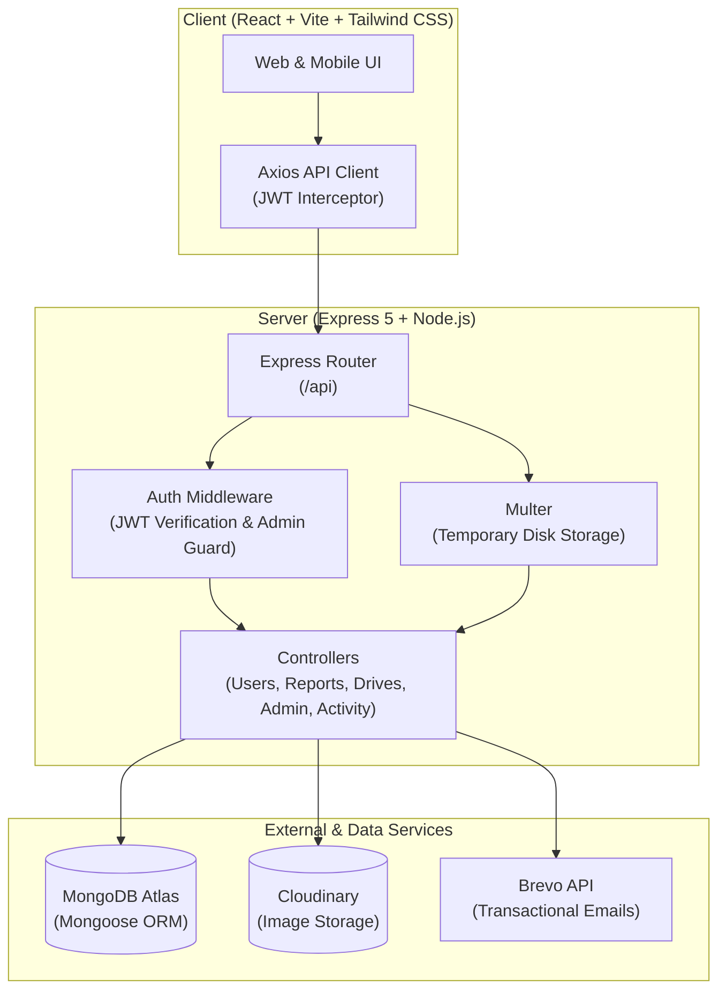

# 🌿 Parisara

> **Empowering Communities for Environmental Action, Civic Reporting, and Collective Impact.**

[](https://nodejs.org/)
[](https://expressjs.com/)
[](https://react.dev/)
[](https://vitejs.dev/)
[](https://www.mongodb.com/)
[](https://tailwindcss.com/)
[](https://cloudinary.com/)

---

## 📖 Overview

**Parisara** (_meaning "Environment" or "Surroundings"_) is a modern, full-stack community-driven platform designed to connect citizens, environmental organizers, and administrators. It empowers local communities to document civic environmental hazards—such as illegal dumping, deforestation, water contamination, and air pollution—mobilize cleanup and conservation drives, track resolution workflows, and hold local ecosystems accountable.

Built with a robust **Node.js/Express** backend and a reactive **React/Vite/Tailwind CSS** frontend, Parisara provides a seamless, mobile-friendly experience for grassroots environmental activism.

---

## ✨ Key Features

### 📍 Geo-Tagged Environmental Reporting

- **Multi-Media Evidence**: Upload high-resolution evidence images processed securely through Cloudinary.
- **Categorization & Tagging**: Classify incidents into _Pollution_, _Waste_, _Deforestation_, _Water_, or _Other_, augmented with custom hashtags.
- **Geospatial Pinpointing**: Tag issues with exact coordinates (GeoJSON `Point`) and human-readable place names.
- **Status Tracking**: Follow issue lifecycle progression from `reported` → `in-progress` → `resolved`.

### 👥 Community Collaboration & Engagement

- **Support / Upvote**: Amplify critical neighborhood reports through community backing.
- **Discussion Threads**: Interactive comment sections on both reports and community drives.
- **Saved Bookmarks**: Bookmark and maintain a personal library of watched reports.
- **Live Activity Streams**: Real-time event log tracking community achievements, newly created reports, and drive registrations.

### 🧹 Grassroots Drives & Action Mobilization

- **Organize Events**: Plan drives for _Cleanup_, _Tree Planting_, _Waste Collection_, _Awareness_, or _Habitat Restoration_.
- **Co-Organizer Delegation**: Assign up to 2 co-organizers with management capabilities.
- **RSVP & Participant Tracking**: Community members can join/leave drives with live participant rosters.
- **Drive Lifecycle**: Mark drives as `planned`, `in-progress`, `completed`, or `cancelled`.

### 🛡️ Administrative Moderation & Role Governance

- **Centralized Admin Dashboard**: Overview metrics displaying reports, resolution rates, and user counts.
- **Report Moderation**: Audit trail for hiding/restoring flagged reports with mandatory moderation reasons.
- **Status Lifecycle Control**: Promote reports through verified resolution stages.
- **Transactional Role Management**: Safe role promotion/demotion using MongoDB transactions and atomic locks (`AdminRoleLock`) preventing accidental removal of the last administrator.

### 🔐 Security & User Profiles

- **Authentication**: Stateless JSON Web Token (JWT) authorization with bcrypt password hashing.
- **Email Verification**: Automated transactional account verification powered by Brevo (Sendinblue) API with expiring secure tokens.
- **Profile Customization**: Customizable user profile avatars hosted on Cloudinary with automatic cleanup of outdated images.

---

## 🏗️ System Architecture



---

## 🛠️ Tech Stack

| Domain            | Technology                                           | Description                                        |
| :---------------- | :--------------------------------------------------- | :------------------------------------------------- |
| **Frontend**      | [React 18](https://react.dev/)                       | Component-driven declarative UI library            |
|                   | [Vite 6](https://vitejs.dev/)                        | Next-generation frontend build tool and dev server |
|                   | [Tailwind CSS 3](https://tailwindcss.com/)           | Utility-first styling with responsive design       |
|                   | [React Router v7](https://reactrouter.com/)          | Client-side declarative routing and navigation     |
|                   | [Axios](https://axios-http.com/)                     | HTTP client with automatic auth token injectors    |
|                   | [Lucide React](https://lucide.dev/)                  | Clean, accessible UI icons                         |
| **Backend**       | [Node.js](https://nodejs.org/)                       | JavaScript runtime environment                     |
|                   | [Express 5](https://expressjs.com/)                  | Fast, unopinionated REST API framework             |
|                   | [Mongoose 9](https://mongoosejs.com/)                | Schema-based MongoDB ODM with transactions         |
|                   | [JWT](https://jwt.io/)                               | Stateless access token authentication              |
|                   | [Bcrypt](https://github.com/kelektiv/node.bcrypt.js) | Salted password hashing algorithm                  |
|                   | [Multer](https://github.com/expressjs/multer)        | Multipart/form-data upload handling                |
| **Cloud & Media** | [Cloudinary](https://cloudinary.com/)                | Scalable cloud image transformation and storage    |
|                   | [Brevo API](https://www.brevo.com/)                  | Transactional email delivery service               |
| **Database**      | [MongoDB Atlas](https://www.mongodb.com/atlas)       | Distributed NoSQL document database                |

---

## 📁 Project Structure

```text
parisara/
├── client/                     # Frontend React application
│   ├── public/                 # Static assets & icons
│   ├── src/
│   │   ├── assets/             # Branding and images
│   │   ├── components/         # Reusable UI components
│   │   │   ├── ActivityFeed.jsx       # Recent community activity stream
│   │   │   ├── AuthLayout.jsx         # Authentication view wrapper
│   │   │   ├── ConfirmDialog.jsx      # Generic confirmation modals
│   │   │   ├── Footer.jsx             # Site footer
│   │   │   ├── MobileNavigation.jsx   # Bottom navigation bar for mobile
│   │   │   ├── Navbar.jsx             # Top desktop navigation
│   │   │   ├── ReportCard.jsx         # Incident card preview
│   │   │   └── ReportImageGallery.jsx # Image carousel / lightbox
│   │   ├── pages/              # View pages & routes
│   │   │   ├── Admin.jsx              # Admin management dashboard
│   │   │   ├── AdminOverview.jsx      # Analytics and overview stats
│   │   │   ├── AdminReports.jsx       # Incident moderation view
│   │   │   ├── AdminUsers.jsx         # User & role administration
│   │   │   ├── CreateDrive.jsx        # Drive organizer form
│   │   │   ├── CreateReport.jsx       # Incident report submission form
│   │   │   ├── DriveDetail.jsx        # Single drive details & RSVPs
│   │   │   ├── Drives.jsx             # Drive discovery feed
│   │   │   ├── Home.jsx               # Main feed with search & filters
│   │   │   ├── Login.jsx              # User login
│   │   │   ├── Profile.jsx            # User profile & saved reports
│   │   │   ├── Register.jsx           # User registration
│   │   │   ├── ReportDetail.jsx       # Report discussion & details
│   │   │   └── VerifyEmail.jsx        # Token email verification landing
│   │   ├── services/
│   │   │   └── api.js                 # Axios instance with interceptors
│   │   ├── App.jsx             # Route definitions and layouts
│   │   └── main.jsx            # DOM entry point
│   ├── package.json
│   ├── tailwind.config.js
│   └── vite.config.js
│
├── server/                     # Backend REST API
│   ├── controllers/            # Route controllers / business logic
│   │   ├── activity.controller.js     # Activity feed handlers
│   │   ├── admin.controller.js        # Moderation and role locks
│   │   ├── comment.controller.js      # Report comments
│   │   ├── drive.controllers.js       # Drives, RSVPs, co-organizers
│   │   ├── reports.controllers.js     # Report CRUD & trending zones
│   │   ├── save.controller.js         # Saved / bookmarked reports
│   │   ├── support.controller.js      # Upvotes & support counters
│   │   └── user.controller.js         # Auth, verification, avatars
│   ├── middleware/             # Express middlewares
│   │   ├── auth.middleware.js         # JWT auth & admin guards
│   │   └── cloudinary.middleware.js   # Multer file handlers
│   ├── models/                 # Mongoose schemas & data models
│   │   ├── activity.model.js
│   │   ├── adminRoleLock.model.js
│   │   ├── comment.model.js
│   │   ├── drive.model.js
│   │   ├── driveComment.model.js
│   │   ├── driveParticipant.model.js
│   │   ├── report.model.js
│   │   ├── save.model.js
│   │   ├── support.model.js
│   │   └── user.models.js
│   ├── routes/                 # Express route definitions
│   │   ├── activity.routes.js
│   │   ├── admin.route.js
│   │   ├── comment.routes.js
│   │   ├── drive.routes.js
│   │   ├── report.routes.js
│   │   ├── save.routes.js
│   │   ├── support.routes.js
│   │   └── userRoutes.js
│   ├── utils/                  # Cloudinary, mailer & activity loggers
│   │   ├── cloudinary.js
│   │   ├── recordActivity.js
│   │   └── sendVerifyEmail.js
│   ├── package.json
│   └── server.js               # Express application entrypoint
│
└── README.md
```

---

## 🚀 Getting Started

### Prerequisites

Ensure you have the following installed on your machine:

- **Node.js** (v18.0.0 or higher) & **npm**
- **MongoDB** (Local instance or [MongoDB Atlas URI](https://www.mongodb.com/atlas))
- **Cloudinary Account** (For image uploads and transformations)
- **Brevo Account** (For sending email verification links via API)

---

### 1. Clone the Repository

```bash
git clone https://github.com/shauryasync/Parisara.git
cd Parisara
```

---

### 2. Backend Setup

1. **Navigate to the server directory**:

   ```bash
   cd server
   ```

2. **Install dependencies**:

   ```bash
   npm install
   ```

3. **Configure Environment Variables**:
   Copy the `.env.example` file to create `.env`:

   ```bash
   cp .env.example .env
   ```

   Edit `.env` with your credentials:

   ```env
   PORT=3000
   MONGODB_URI=mongodb+srv://<username>:<password>@cluster.mongodb.net/parisara?retryWrites=true&w=majority
   JWT_SECRET=your_jwt_secret_key_here

   # Cloudinary credentials
   CLOUDINARY_CLOUD_NAME=your_cloudinary_cloud_name
   CLOUDINARY_API_KEY=your_cloudinary_api_key
   CLOUDINARY_API_SECRET=your_cloudinary_api_secret

   # Client App URL
   CLIENT_URL=http://localhost:5173

   # Brevo Email Configuration
   EMAIL_FROM=no-reply@parisara.org
   BREVO_API_KEY=your_brevo_api_key_here
   ```

4. **Start the backend server**:

   ```bash
   # Development mode with hot-reload
   npm run dev

   # Production mode
   npm start
   ```

   The API will be running at `http://localhost:3000`.

---

### 3. Frontend Setup

1. **Navigate to the client directory**:

   ```bash
   cd ../client
   ```

2. **Install dependencies**:

   ```bash
   npm install
   ```

3. **Configure Environment Variables**:
   Copy `.env.example` to create `.env`:

   ```bash
   cp .env.example .env
   ```

   Ensure the API endpoint points to your backend:

   ```env
   VITE_API_URL=http://localhost:3000/api
   ```

4. **Start the Vite development server**:
   ```bash
   npm run dev
   ```
   Open your browser at `http://localhost:5173`.

---

## 📡 API Reference

### 🔐 Authentication & Profile (`/api`)

| Method  | Endpoint                   |  Auth  | Description                                         |
| :------ | :------------------------- | :----: | :-------------------------------------------------- |
| `POST`  | `/api/register`            | Public | Register a new user and triggers verification email |
| `POST`  | `/api/login`               | Public | Authenticate user and receive JWT token             |
| `GET`   | `/api/verify-email?token=` | Public | Verify user email address with token                |
| `GET`   | `/api/me`                  |  User  | Get current logged-in user profile details          |
| `PATCH` | `/api/me/avatar`           |  User  | Upload and update profile avatar                    |

### 📝 Environmental Reports (`/api/reports`)

| Method   | Endpoint                                          |   Auth   | Description                                               |
| :------- | :------------------------------------------------ | :------: | :-------------------------------------------------------- |
| `POST`   | `/api/reports/create-report`                      |   User   | Submit a new environmental incident report with images    |
| `GET`    | `/api/reports/get-reports`                        | Optional | Fetch all visible reports (supports filters & pagination) |
| `GET`    | `/api/reports/trending-zones`                     |  Public  | Fetch aggregated hotspots and trending zones              |
| `GET`    | `/api/reports/get-reports/:id`                    | Optional | Retrieve full details of a specific report                |
| `PATCH`  | `/api/reports/get-reports/:id`                    |   User   | Update report details (author only)                       |
| `DELETE` | `/api/reports/get-reports/:id`                    |   User   | Delete an environmental report (author only)              |
| `PATCH`  | `/api/reports/get-reports/:id/images/:imageIndex` |   User   | Replace a specific image in a report                      |
| `DELETE` | `/api/reports/get-reports/:id/images/:imageIndex` |   User   | Remove a specific image from a report                     |

### 🤝 Engagement & Community (`/api/reports`)

| Method   | Endpoint                           |   Auth   | Description                                |
| :------- | :--------------------------------- | :------: | :----------------------------------------- |
| `POST`   | `/api/reports/:id/support`         |   User   | Support / upvote a report                  |
| `GET`    | `/api/reports/:id/support`         |   User   | Check if current user has supported report |
| `DELETE` | `/api/reports/:id/support`         |   User   | Remove support from a report               |
| `POST`   | `/api/reports/:id/comments`        |   User   | Add a comment to a report                  |
| `GET`    | `/api/reports/:id/comments`        | Optional | Get all comments for a report              |
| `DELETE` | `/api/reports/comments/:commentId` |   User   | Delete comment (comment author only)       |
| `POST`   | `/api/reports/:id/save`            |   User   | Bookmark / save a report to profile        |
| `GET`    | `/api/reports/:id/save`            |   User   | Check bookmark status for report           |
| `DELETE` | `/api/reports/:id/save`            |   User   | Remove saved bookmark                      |
| `GET`    | `/api/reports/saved`               |   User   | Retrieve list of all reports saved by user |

### 🌲 Community Drives (`/api/drives`)

| Method   | Endpoint                                |   Auth    | Description                                |
| :------- | :-------------------------------------- | :-------: | :----------------------------------------- |
| `POST`   | `/api/drives`                           |   User    | Create a new cleanup or conservation drive |
| `GET`    | `/api/drives`                           | Optional  | List upcoming and active drives            |
| `GET`    | `/api/drives/:id`                       | Optional  | Get detailed information for a drive       |
| `PATCH`  | `/api/drives/:id`                       | Organizer | Edit drive details                         |
| `PATCH`  | `/api/drives/:id/cancel`                | Organizer | Cancel a planned drive                     |
| `PATCH`  | `/api/drives/:id/complete`              | Organizer | Mark a drive as successfully completed     |
| `POST`   | `/api/drives/:id/join`                  |   User    | RSVP / join a drive                        |
| `DELETE` | `/api/drives/:id/join`                  |   User    | Leave a drive                              |
| `GET`    | `/api/drives/:id/participants`          | Optional  | Retrieve list of confirmed participants    |
| `POST`   | `/api/drives/:id/co-organizers`         | Organizer | Add co-organizer (max 2)                   |
| `DELETE` | `/api/drives/:id/co-organizers/:userId` | Organizer | Remove co-organizer                        |
| `POST`   | `/api/drives/:id/comments`              |   User    | Comment on drive discussion board          |
| `GET`    | `/api/drives/:id/comments`              | Optional  | Retrieve all drive comments                |

### ⚡ Activity Stream (`/api/activity`)

| Method | Endpoint        | Auth | Description                                     |
| :----- | :-------------- | :--: | :---------------------------------------------- |
| `GET`  | `/api/activity` | User | Fetch real-time recent community activity items |

### 👑 Admin Moderation (`/api/admin`)

| Method  | Endpoint                         | Auth  | Description                                           |
| :------ | :------------------------------- | :---: | :---------------------------------------------------- |
| `GET`   | `/api/admin/reports`             | Admin | View all reports including hidden/moderated items     |
| `PATCH` | `/api/admin/reports/:id/status`  | Admin | Update status (`reported`, `in-progress`, `resolved`) |
| `PATCH` | `/api/admin/reports/:id/hide`    | Admin | Hide a report from the public feed with a reason      |
| `PATCH` | `/api/admin/reports/:id/restore` | Admin | Unhide / restore a moderated report                   |
| `GET`   | `/api/admin/users`               | Admin | List all registered platform users                    |
| `PATCH` | `/api/admin/users/:id/role`      | Admin | Update user role (`user` / `admin`) with safe locks   |

---

## 🔒 Security Best Practices Implemented

- **Password Hashing**: Passwords stored using `bcrypt` with automated salt generation.
- **Stateless Session Control**: Verified via `jsonwebtoken` bearer tokens in HTTP headers.
- **Role Elevation Concurrency Guards**: Demoting administrators or updating permissions uses MongoDB sessions and transactions to guarantee that the system can never be left with zero admins.
- **Resource Ownership Validation**: Edits and deletions on reports and drives are strictly bounded to resource owners or designated co-organizers.
- **Input Sanitization**: Whitelisted schema attributes, trimmed input strings, and regex email validation.
- **Safe Media Storage**: Uploads use temporary disk staging with Multer, immediate streaming to Cloudinary, and guaranteed unlinking of local temporary files.

---

## 🤝 Contributing

Contributions to make our environment cleaner and greener are always welcome!

1. **Fork** the repository
2. **Create a feature branch**:
   ```bash
   git checkout -b feature/AmazingFeature
   ```
3. **Commit your changes**:
   ```bash
   git commit -m "Add some AmazingFeature"
   ```
4. **Push to the branch**:
   ```bash
   git push origin feature/AmazingFeature
   ```
5. **Open a Pull Request**

---

## 👨‍💻 Author

Developed with ❤️ by **[Shaurya Pratap Singh](https://github.com/shauryasync)**.
